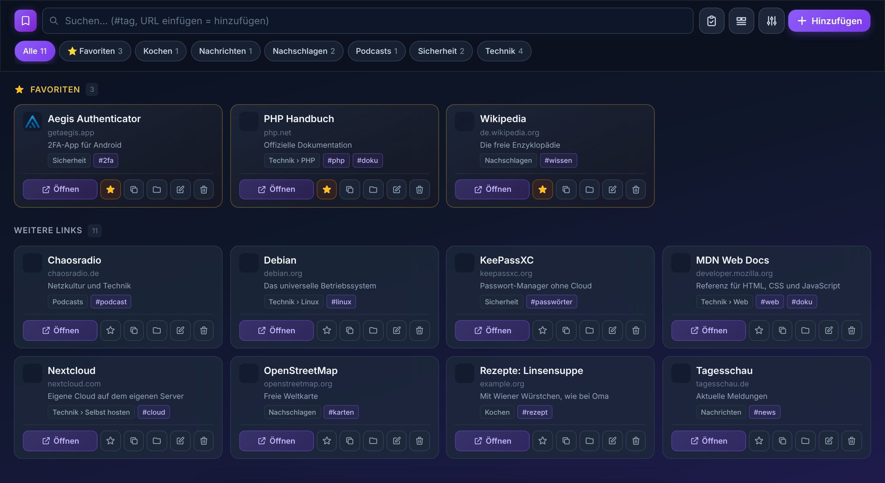
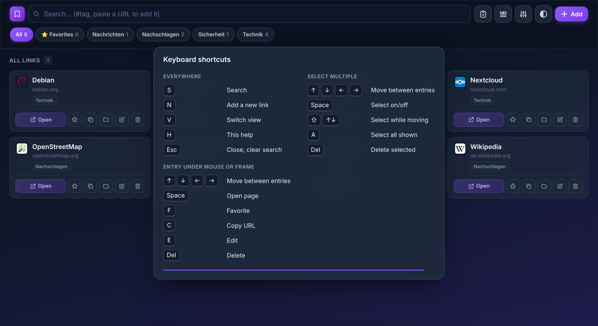

# LinkVault

A self-hosted bookmark manager in **plain PHP**, installed with one single file. No database, no dependencies, no build step, no requests to third-party servers. Every user's bookmarks are stored encrypted with AES-256-GCM, and the key that opens them is protected by that user's password.

Upload `linkvault-install.php`, open it in the browser, create the first account. That's the whole installation.

> The interface is available in German and English (switchable in the app). The code comments are German.

**Deutsche Fassung: [README.md](README.md)**



*Sample data, made up for the screenshot.*

## Features

- Bookmarks with nested folders, tags, favourites, notes, full-text search
- Import from browser bookmark files (HTML, including very large ones and Firefox notes), export as HTML or JSON
- Three views: cards, list and tiles. Each of them shows a link's address at a glance, on phones too.
- Trash with 30 days retention, duplicate finder, dead-link checker
- Auto-sort (Tools → Auto-sort): suggests tags and folders without any AI and without outside services. It goes by groups of domains and keywords (YouTube → video, GitHub → dev, “*xxx*” → NSFW, …) and the way you have sorted so far. The groups are one single list you can change, extend and delete completely, “Restore defaults” brings back the original. You get a preview to tick off first, a backup is made before anything changes, and there is an undo button afterwards.
- Tag bar below the folders: tap a tag to filter by it, several can be combined (can be switched off under View)
- Manage tags and manage folders: rename, merge, delete. Deleting always keeps the links, and there is an undo button afterwards.
- Automatic daily snapshots plus a snapshot before every bulk action
- Encrypted full backup as a single downloadable file (`.lvbak`)
- Multiple users, each with their own key and their own separate vault
- Two-factor login (TOTP), recovery code, login history
- Installable as a PWA, works without any CDN (font and CSS are embedded)
- Light and dark mode with three colour variants each (violet, blue, green), optionally following the device setting
- Interface in German and English, switchable under Tools → Appearance & language (every user has their own settings, stored with their account and applied on every device)
- Fully usable with the keyboard on the desktop, `H` shows all shortcuts

### Keyboard shortcuts

Press `H` to show an overview. It disappears on its own after 10 seconds.



| Key | Action |
|---|---|
| `S` | Search (also `/` and `Ctrl+K`) |
| `N` | Add a new link |
| `V` | Switch view |
| `H` | Show or hide the help |
| `Esc` | Close, clear search |
| `↑` `↓` `←` `→` | Move between entries |
| `Space` | Open the page of the chosen entry |
| `F` / `C` / `E` / `Del` | Favourite, copy URL, edit, delete (entry under the mouse or in the frame) |

In multi-select mode `Space` selects the entry, `Shift` + arrow key selects while moving, `A` selects all entries shown and `Del` deletes the selected ones.

## Requirements

- PHP 7.4 or newer (8.x recommended) with the `openssl` extension
- A web server that runs PHP (Apache works out of the box, Nginx needs one extra rule, see below)
- **HTTPS.** Without it your password travels in clear text and the rest of this document is moot.
- Optional: `sodium` (sealed login history), `curl` (title fetch, link check), `dom` (bookmark import), `mbstring`, `intl`

## Installation

1. Download `linkvault-install.php` from the [latest release](../../releases/latest) and copy it into a directory on your web server.
2. Make sure PHP may write to that directory (it creates `index.php`, the folder `app/` and later `data/` there).
3. Open `linkvault-install.php` in the browser **immediately** and click "Install now". The file unpacks the program, deletes itself and redirects. Create the first account there. This account is the administrator.
4. Check that `data/` is not reachable from outside (see "Protect the data directory").
5. In *Tools → Account & security*: create a recovery code and switch on two-factor login.

> The first visitor who opens a freshly uploaded, not yet configured LinkVault becomes the administrator. Do step 3 right after uploading.

**Prefer doing it by hand?** The release also contains `linkvault-<version>.zip`. Unpack it and upload the contents of the folder `linkvault/`, that is `index.php` **and** the folder `app/`. If you clone the repository, those two are all you need.

### Layout

```
index.php      entry point and settings
app/lib/       functions (storage, accounts, encryption, login, outbound requests, import, interface)
app/routes/    font, icon, manifest, favicons and all JSON actions
app/views/     login page and main page (HTML, CSS, JavaScript)
data/          created at first start, everything secret lives here
```

The files in `app/` do nothing when requested directly, everything goes through `index.php`. On Apache an `.htaccess` locks the folder as well.

### Protect the data directory

LinkVault writes `.htaccess` files that block all access to `data/`. That works on Apache if `AllowOverride` is enabled. Nginx ignores `.htaccess`, so add this to your `server { }` block (the same snippet is written to `data/nginx-deny.conf`):

```nginx
location ^~ /linkvault/data/ {
    deny all;
    return 404;
}
```

The path has to match the folder LinkVault lives in, `/linkvault/` in this example. If it sits directly in the web root, use `location ^~ /data/ {`. If the path is wrong, the rule never matches and `data/` is open. LinkVault writes the matching path into `data/nginx-deny.conf` for you.

Test it. This must **not** return 200:

```bash
curl -sS -o /dev/null -w '%{http_code}\n' https://your-domain.example/linkvault/data/lv_auth.json
```

LinkVault checks this itself as well: if `data/` can be fetched from outside, the administrator gets a clear warning after signing in, every time, until the folder is locked.

Everything in `data/` is encrypted or hashed, so a leak is not an instant disaster. But it would hand an attacker the material for offline password guessing, and that is exactly what you don't want.

## Accounts and roles

- The **first account** is the administrator.
- Anyone else can **request access** on the login page by choosing a user name and a password. The account is created right away with its own key, but stays locked until the administrator approves it.
- The administrator can approve, reject, block, unblock and delete users, and can close registration completely.
- The administrator **cannot read other users' bookmarks** and **cannot reset their passwords**. There is no master key. A user who loses both password and recovery code has lost the data, by design.
- Limits against abuse: at most 3 requests per network address per day, 20 pending requests, 50 users in total.

## How your data is protected

### Key hierarchy

```
password ──PBKDF2-SHA256, 600,000 rounds, random 16-byte salt──▶ key-encryption key (KEK)
                                                                      │
random 256-bit data key (DEK) ◀──unwrapped with AES-256-GCM──────────┘
        │
        └──AES-256-GCM, fresh random 96-bit nonce on every write──▶ bookmarks, backups, TOTP secret
```

- Each user gets an own random 256-bit data key, created with PHP's CSPRNG (`random_bytes`) at account creation.
- The data key is never written to disk in the clear. It is stored only *wrapped* with a key derived from the password.
- Changing the password re-wraps the same data key. The bookmarks don't need to be re-encrypted.
- AES-GCM is authenticated encryption. Tampered files fail to decrypt instead of yielding garbage.
- If no key is available, LinkVault refuses to save rather than falling back to plain text.

### What is stored on the server

| File | Content | Readable without the password? |
|---|---|---|
| `data/bookmarks.json`, `data/users/<id>/bookmarks.json` | bookmarks | No (AES-256-GCM) |
| `…/backups/*.json` | snapshots of the above | No (AES-256-GCM) |
| `data/lv_auth.json`, `…/auth.json` | user name, password hash (`password_hash`, bcrypt), salt, wrapped data key, encrypted TOTP secret, settings | User name and settings yes, everything secret no |
| `data/autosort.json`, `…/autosort.json` | your version of the auto-sort groups | No (AES-256-GCM) |
| `data/ui.json`, `…/ui.json` | per-user interface settings: colour scheme, language, layout, sorting | Yes (nothing secret) |
| `…/state.json` | account status (pending / active / blocked), timestamps, sealed registration note | Status and timestamps yes |
| `…/attempts.log` | login history: time, IP address, attempted name | No, if `sodium` is available (see below) |
| `…/favicon_cache/` | site icons | No (AES-256-GCM). File names are keyed HMACs, so they don't reveal the domain. |
| `data/throttle/` | failed-login counters and markers for known connections, file names are SHA-256 hashes of the address | Counters yes, addresses no |
| `data/sessions/` | PHP sessions | The data key in there is encrypted (see below) |

There is nothing else. No database and no log file that contains your URLs or the domains you bookmarked.

### Sessions

After login the data key has to be available for each request. It is **not** stored in the session in the clear:

- A random 256-bit session key is generated and sent to the browser as a cookie (`HttpOnly`, `SameSite=Lax`, `Secure` on HTTPS).
- The session file on the server only contains the data key encrypted with that cookie key.
- Somebody who copies the session files from the server gets nothing usable. Both halves are needed.
- Sessions live in LinkVault's own directory, not in the shared `/tmp` of the hoster.
- Session ID is regenerated at login. Idle timeout is configurable (15 minutes to 30 days, default 8 hours).
- Changing the password logs out all other devices.

### Login protection

- Passwords: at least 12 characters with letters and digits. Stored only as a `password_hash()` hash.
- Rate limiting per address with growing lock times (3 s, 10 s, 30 s, 60 s … up to 15 minutes). IPv6 addresses are grouped by /64. Only `REMOTE_ADDR` is trusted, never `X-Forwarded-For`.
- A global brake slows everyone down briefly when failed logins pile up from many addresses. Connections that someone signed in from successfully during the last 30 days are exempt, so nobody can lock you out with a flood of failed attempts.
- Unknown user names take the same time as wrong passwords, and the reason for a refusal (pending, blocked) is only revealed after the correct password.
- **Two-factor login (TOTP, RFC 6238)**: works with Aegis, 2FAS, Google Authenticator and so on. The TOTP secret is stored encrypted with the data key. Each code is accepted only once.
- **Recovery code**: 24 random characters (120 bits). It wraps a second copy of the data key. Using it sets a new password, invalidates the code and switches TOTP off (a lost phone is the usual reason to need it).
- Sensitive actions (password change, TOTP on/off, new recovery code, deleting a user) ask for the current password again. Five wrong entries end the session.
- **Login history**: every attempt is logged with time, address and attempted name, sealed with a public key (`sodium_crypto_box_seal`). The server can write entries but only the logged-in owner can read them. After login you see what happened since your last visit.

### Browser-side hardening

- Strict Content Security Policy: `default-src 'none'`, scripts only with a per-request nonce, no external sources of any kind, `frame-ancestors 'none'`, `form-action 'self'`
- `X-Frame-Options: DENY`, `X-Content-Type-Options: nosniff`, `Referrer-Policy: no-referrer`, `Cross-Origin-Opener-Policy` and `Cross-Origin-Resource-Policy: same-origin`, HSTS on HTTPS, `X-Robots-Tag: noindex`
- CSRF token on every state-changing request, compared in constant time. All API actions are POST-only.
- Only `http://` and `https://` links are accepted. `javascript:`, `data:` and friends are rejected, also on import.

### Privacy

- **No third-party requests from your browser.** Font (Inter) and CSS are embedded in the file. No CDN, no analytics, no Google Fonts, no external favicon service.
- Favicons and page titles are fetched **by your server directly from the bookmarked site**, not through Google or DuckDuckGo.
- These outgoing requests are protected against SSRF: only public IP addresses are allowed, the connection is pinned to the address that was checked, every redirect hop is checked again, and TLS certificates are verified.
- The only external link in the UI is an optional "open in the Internet Archive" link for dead bookmarks, and it does nothing until you click it.

## What this does not protect against

Honest limits, so you can decide for yourself:

- **This is encryption at rest on the server, not end-to-end encryption.** Your password is sent to the server (over HTTPS) at login, and while a request is being processed the data key exists in the server's memory. Somebody who controls the server *while you use it* (a malicious hoster, an attacker who can modify `index.php`) can capture your password or your data. What the design does protect against: stolen or leaked files, stolen server backups, a misconfigured web server exposing `data/`, a curious co-tenant or admin browsing the disk.
- **A weak password stays a weak password.** Anyone who obtains `auth.json` can try passwords offline. PBKDF2 with 600,000 rounds and bcrypt make that slow, not impossible. Use a long, unique password, ideally from a password manager.
- **TOTP protects the login, not the files.** It stops someone who knows your password from logging in through the web page. It does not add anything against someone who has both your password *and* a copy of the files, because the data key can then be unwrapped directly.
- **Metadata is visible on the server:** user names, number of users, account status, file sizes and modification times.
- **The sites you bookmark see your server's IP address** when LinkVault fetches a title or icon or checks a link.
- **The administrator can delete** accounts including their data, and whoever has file access to the server can do that too. Keep your own `.lvbak` backup.
- **No password, no data.** There is no reset by e-mail and no back door. Create the recovery code and keep it somewhere safe.
- This is a hobby project. It has not been audited by an independent security firm. The code is readable PHP without dependencies, so please do look for yourself.

## Backups

- Automatic: one snapshot per day (14 kept) and one before each bulk action (10 kept), per user, encrypted like the live data.
- Manual: *Tools → Backups* downloads a `.lvbak` file containing the encrypted data plus the wrapped key. It is useless without the password that was valid at the time of the download, and it can be imported into any LinkVault installation.
- For a complete copy of the installation, back up the whole `data/` directory.

## Configuration

A few constants at the top of `index.php`:

| Constant | Default | Meaning |
|---|---|---|
| `LV_KDF_ITERS` | `600000` | PBKDF2 rounds. Raising it upgrades existing keys at the next login. |
| `LV_IDLE_DEFAULT` | `480` | Minutes of inactivity before automatic logout (per user changeable in the UI) |
| `LV_SESSION_MAX_DAYS` | `30` | Maximum session lifetime |
| `LV_MAX_PENDING` / `LV_MAX_USERS` | `20` / `50` | Limits for access requests and users |
| `BACKUP_KEEP_DAILY` / `BACKUP_KEEP_PRE` | `14` / `10` | How many snapshots are kept |
| `LV_TRASH_DAYS` | `30` | Retention of deleted bookmarks |
| `LV_TAILWIND_CDN` | `false` | Development only. `true` loads Tailwind from a CDN and loosens the CSP. Leave it off. |
| `LV_AUTH_ENABLED` | `true` | **Never set this to `false` on a reachable server.** It disables login and encryption. |

## Updating

Upload the new `linkvault-install.php` and open it. It detects the existing installation, replaces only `index.php` and `app/` and deletes itself again. `data/` stays untouched. Older data formats are migrated automatically at the next login.

By hand it works the same way: replace `index.php` and the folder `app/` with the new version.

**Coming from 3.5.0 or older:** Until then LinkVault was just `index.php`. Since then the folder `app/` belongs to it. If you only swap `index.php`, you get a message that `app/` is missing. Re-apply your own values for the constants at the top of `index.php` afterwards.

### Building a release

Only for people who want to distribute LinkVault themselves, nobody needs this to use it:

```bash
php tools/build-release.php
```

This creates `dist/linkvault-install.php` and `dist/linkvault-<version>.zip`. In the repository a workflow does this whenever a tag like `v3.6.0` is pushed.

## Never publish `data/`

The code contains no credentials, keys or personal data. Everything secret is created at first start and lives in `data/`. The `.gitignore` in this repository excludes it. Keep it that way.

## Reporting security issues

Please open an issue. If the problem is exploitable, describe it without a working exploit first.

## License

GNU Affero General Public License v3.0, see [LICENSE](LICENSE). You may use, study, change and share LinkVault freely, privately or commercially. If you pass it on or sell it, changed or unchanged, you must do so under the same license and include the source. The same applies if you offer a modified version to others as a service over a network: you have to publish your source as well.

## Credits

Typeface: [Inter](https://github.com/rsms/inter) by Rasmus Andersson, SIL Open Font License 1.1, embedded as a subset.
CSS utilities generated with [Tailwind CSS](https://tailwindcss.com) (MIT License), embedded.
